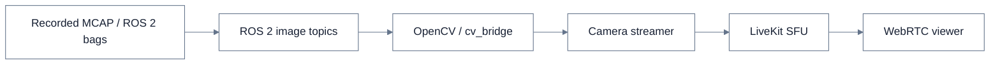

# ROS 2 Jazzy Robot Telemetry Pipeline

**A reproducible pipeline for simulated robot telemetry, MQTT messaging, and optional camera streaming.**

This project connects a ROS 2 Jazzy robot simulator to a small backend. GPS, odometry, and diagnostic messages travel through an MQTT bridge, are persisted in SQLite, and can be queried through a read-only FastAPI service.

[View source on GitHub](https://github.com/myselfmankar/ros2-jazzy)

## Core telemetry architecture

```mermaid
%%{init: {'theme':'base','themeVariables': {'primaryColor':'#ffffff','primaryTextColor':'#172033','primaryBorderColor':'#64748b','lineColor':'#64748b','secondaryColor':'#f1f5f9','tertiaryColor':'#f8fafc','fontFamily':'Inter, sans-serif'}}}%%
flowchart LR
    subgraph R[ROS 2 Jazzy]
      SIM[Mock Robot Simulator]
      GPS[/gps/fix]
      ODOM[/odom]
      DIAG[/diagnostics]
      SIM --> GPS
      SIM --> ODOM
      SIM --> DIAG
    end
    GPS --> BR[ROS 2 ↔ MQTT Bridge]
    ODOM --> BR
    DIAG --> BR
    BR <-->|Telemetry and control topics| MQ[Mosquitto]
    MQ --> CON[Telemetry Consumer]
    CON --> DB[(SQLite)]
    DB --> API[FastAPI · Read-only]
    API --> CLIENT[HTTP Clients]
```

## Optional camera workflow

A separate companion package can replay recorded ROS 2 image topics and publish a selected camera feed to LiveKit using WebRTC.



## What it demonstrates

- **ROS 2 integration:** publishing simulated GPS, odometry, and diagnostic telemetry.
- **Bidirectional messaging:** translating ROS 2 data and control commands to MQTT topics.
- **Persistence:** validating and storing incoming telemetry in SQLite.
- **Backend access:** exposing health, GPS, odometry, diagnostics, and logs through FastAPI.
- **Real-time media path:** an optional recorded-camera workflow using ROS 2 image topics and LiveKit WebRTC.

## Try the core demo

With Docker Engine and Docker Compose installed:

```bash
docker compose up --build -d
docker compose ps
```

The simulator starts with its telemetry session inactive. Activate it through the local MQTT broker, then inspect the API at [http://localhost:8000/docs](http://localhost:8000/docs).

See the [README](./README.md) for prerequisites, commands, API examples, tests, and the optional video workflow.

> **Scope and safety:** The default telemetry demo uses synthetic robot data. The video path replays recordings; it is not a live hardware deployment. The bundled MQTT configuration is for local development and should not be exposed to an untrusted network or connected to a physical robot without appropriate authentication and independent safety controls.

---

<sub>Project showcase · ROS 2 Jazzy · Python · MQTT · SQLite · FastAPI · LiveKit · WebRTC</sub>
